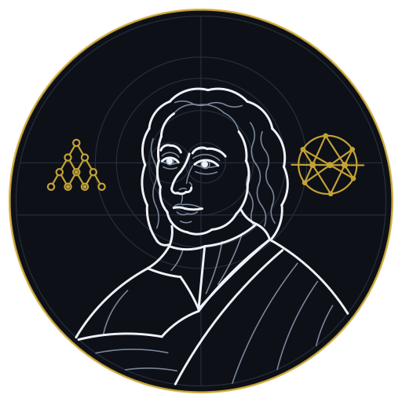

.. container:: author-overline

   semantic digital archive • the works of

=============
Blaise Pascal
=============

At sixteen years old, **Blaise Pascal** (1623–1662) printed a single-page broadside in Paris that changed projective geometry forever. Inscribed in any circle, ellipse, parabola, or hyperbola, any hexagon's three pairs of opposite sides meet at three points that always lie on a single straight line—the *hexagrammum mysticum*, a single master lemma from which Pascal deduced hundreds of conic corollaries.

Books in This Collection
------------------------

.. container:: home-book-hero

   .. container:: home-book-thumb

      .. image:: _static/constructions/pascal_hexagrammum.svg
         :alt: Blaise Pascal 1640 Hexagrammum Mysticum inscribed in a conic section
         :target: essay_coniques_1640/index.html

   .. container:: home-book-body

      .. rubric:: Paris Broadside · February 1640 · 4 Synchronized Tracks · 4 Vector Plates

      **Essay on Conics** (*Essay pour les Coniques*) — The complete 1640 *placard* across **English · French · Summary · Notes**, paired with **4 calibrated interactive vector plates** exploring the Mystic Hexagram, Steiner's 60 Pascal lines, and the golden-ratio :math:`\mathbb{Q}(\phi)` hexagram.

      .. container:: home-actions

         * :doc:`Open Essay on Conics → <essay_coniques_1640/index>`
         * :doc:`Read English Text → <essay_coniques_1640/essay-coniques/index>`
         * :doc:`Original 1640 French → <essay_coniques_1640/essay-coniques/fr>`
         * :doc:`Symbolic Notes → <essay_coniques_1640/essay-coniques/notes>`

Key Features
------------

.. container:: home-feature-grid

   .. container:: home-feature-card

      **The Mystic Hexagram (Lemma III)**

      Trace Pascal's 1640 broadside from projective *ordonnances de lignes* and Desargues's perspective framework to the collinearity of opposite-side intersections on any conic.

   .. container:: home-feature-card

      **Four-Track Bilingual Scriptorium**

      Compare the Brunschvicg–Boutroux critical French text side-by-side with Frances Marguerite Clarke's English translation, executive summary, and historical commentary.

   .. container:: home-feature-card

      **Exact** :math:`\mathbb{Q}` **&** :math:`\mathbb{Q}(\phi)` **Projective Models**

      Interactive plates verify Pascal's line on rational unit-circle configurations, ellipses, Steiner triple concurrences, and golden-section hexagrams in ``geometor.pascal``.

Reference & Project
-------------------

.. container:: home-columns

   .. container:: home-col

      .. rubric:: Scholarly Apparatus

      * :doc:`People <people/index>` — Profiles of Blaise Pascal, Girard Desargues, Pappus of Alexandria, Apollonius, Jakob Steiner, and Julius Plücker
      * :doc:`Bibliography <bibliography>` — 1640 Paris broadside, *Œuvres* (1908/1923), and foundational projective treatises
      * :doc:`Glossary <glossary>` — Early modern French and projective geometry terminology

   .. container:: home-col

      .. rubric:: About This Project

      * :doc:`About <about/index>` — Editorial scope, symbolic projective algebra, and provenance
      * :doc:`Using This Edition <usage/index>` — Track switching, cross-references, and reading guide

.. toctree::
   :maxdepth: 2
   :hidden:

   essay_coniques_1640/index
   people/index
   bibliography
   glossary
   about/index
   usage/index
